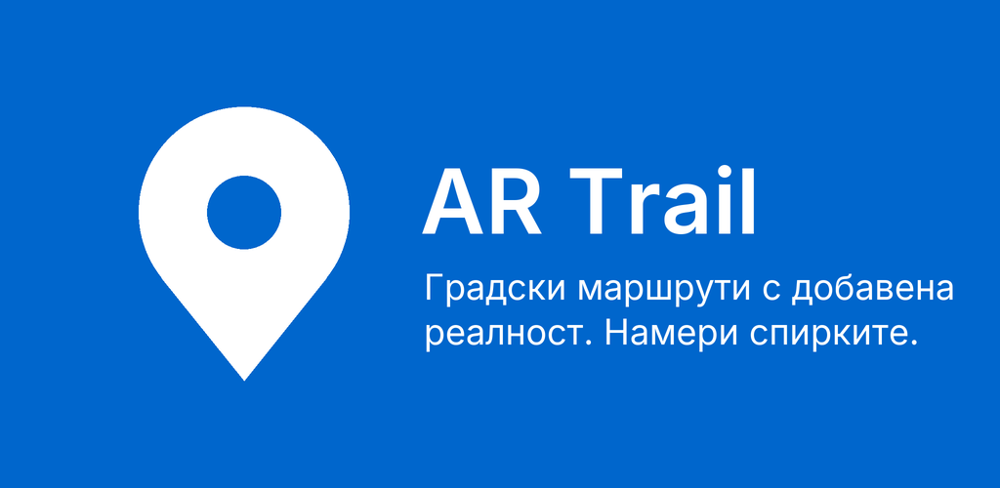
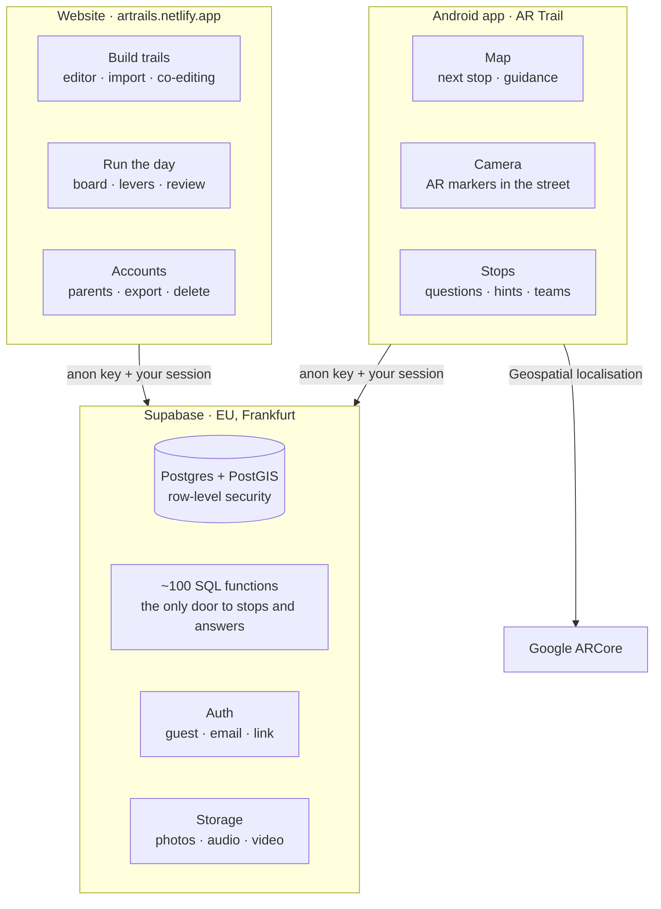
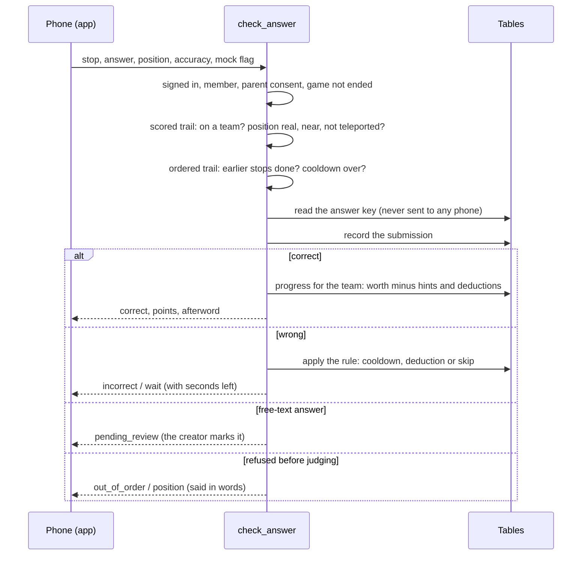
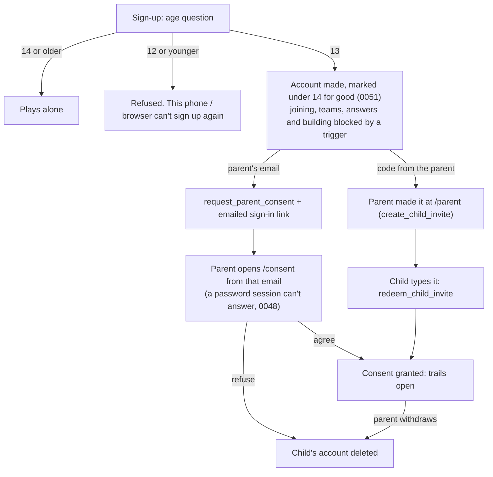

<p align="center"></p>

# AR Trail: the platform

The website, the database and the paperwork behind **AR Trail**, city trails
in augmented reality. The Android app is in
[`AR-Trails`](https://github.com/ZalexZal/AR-Trails).

**Live site:** [artrails.netlify.app](https://artrails.netlify.app) ·
**App:** 0.6.1 (build 21) · **Database:** migrations 0001–0054 ·
**Terms version:** 2026-09-29

## Contents

- [The idea](#the-idea)
- [The point](#the-point)
- [How it fits together](#how-it-fits-together)
- [What it does](#what-it-does)
- [How it works inside](#how-it-works-inside)
- [Running it](#running-it)
- [Repository layout](#repository-layout)
- [Version history](#version-history)
- [Database migrations](#database-migrations)
- [Status](#status)
- [Law, privacy and safety](#law-privacy-and-safety)
- [Credits](#credits)

## The idea

AR Trail turns a walk through a town into a trail of stops that stand in the
street in augmented reality.

Somebody who knows a place (a teacher, a guide, an organiser) builds a trail on
the website. They drop stops on a map and fill each one with text, photos,
audio, video and a question. People walk the trail with the Android app. The map
leads them to each stop. When they raise the phone, the stop stands on its real
spot through the camera, pinned there by Google's ARCore Geospatial service.
Tapping it opens what the creator left there.

The same engine runs four kinds of trail:

| | Walked in order | In any order |
|---|---|---|
| **Keeps a score** (teams, points, leaderboard, priced hints) | Competition (`ctf`) | Freefall (`freefall`) |
| **No score** (questions still asked and answered) | Guided (`guide`) | Educational (`educational`) |

AR Trail was built in Yambol, Bulgaria, by Alexander Zamov, for NOIT, Bulgaria's
national olympiad in information technology. Everything is in Bulgarian and
English.

## The point

City games in Yambol already run as stations: a QR code at each place and
answers sent through a web form. They work, but the phone only ever shows a
form. Nothing stands
at the place itself. AR Trail keeps what those games do well (teams, questions,
a board everyone watches) and adds the part they can't do: the content waits at
the spot where it belongs, and you have to go there to get it.

Four goals shaped every decision:

1. **Anyone can make a trail without writing code.** The website builds it: a
   map, a form per stop, both languages, a spreadsheet import for long trails,
   and co-editing for a class or a team of organisers.
2. **You have to be there.** A stop's contents open only when you stand at it:
   by tapping the AR marker, or from inside the stop's radius when AR can't
   calibrate. On scored trails the server also checks where each answer came
   from, and it refuses answers sent from a fake-location app, from across town,
   or after an impossibly fast jump.
3. **Games have to be fair.** The phone never receives an answer. It is told
   what to ask, never what is right. Every rule is enforced by the database: the
   order, the hints, the cooldown after a wrong answer, and the end of a game. A
   modified app gains nothing.
4. **It has to be safe and lawful to put in front of school children.** It has
   reporting, blocking, a review queue before anything becomes public, removal
   notices, parental consent at 13, a parent account, and data export and
   deletion for everyone. GDPR, the Bulgarian Personal Data Protection Act, the
   EU Digital Services Act, Google Play's policies and ARCore's terms are handled
   in code and written down in [`docs/legal`](https://github.com/ZalexZal/noit-platform/tree/main/docs/legal).

## How it fits together

Two clients, one backend. The website and the app never talk to each other.
Both are clients of the same Supabase project, and the database holds the only
truth.



The two repositories:

| Repository | What is in it |
|---|---|
| [`noit-platform`](https://github.com/ZalexZal/noit-platform) | The website (`web/`), every database migration (`supabase/migrations/`), the end-to-end seam test (`tests/`), the legal file (`docs/legal/`), the Play Store kit (`docs/play-store/`) and the design handbooks |
| [`AR-Trails`](https://github.com/ZalexZal/AR-Trails) | The Unity project for the Android app: scripts, the generated UI, the build and preview tools, the icon |

## What it does

Everything below is built. The [status](#status) section says what has been
proven on a real phone and what still waits for a field test.

### For a walker (the app)

**First run**
- Welcome → terms with the one question the app asks: your age (14 or older /
  13 / 12 or younger) → a practice trail.
- The practice trail puts three stops around wherever you stand, all open from
  there. One of them asks a question. Answers are judged on the phone and never
  sent, so practice never lands on a leaderboard. It ends on "You're ready" and
  the two ways into a real trail.
- Location is asked for once the app is usable. The camera is asked for the
  first time you open the Camera tab, never earlier.

**Getting onto a trail**
- A six-letter trail code, typed into six boxes (letters that look alike, such
  as 0/O and 1/I/L, are never used).
- A link or QR code from the website (`artrail://join/<trail>`), which works only
  for trails that are publicly listed.
- **Near you**: public trails whose first stop is close by, joined with one tap.
- Games (scored trails) ask you to make or join a team before the first stop,
  and need an account rather than a guest session.

**Map tab**
- A street map across the whole screen (Stadia Maps Outdoors at double
  resolution, with shops, churches and banks named, because "past the bank,
  then left" is a direction). Tiles are cached, so a street walked once works
  without signal.
- At the top, the **trail pill**: the trail's name, its kind, how many stops are
  found and, on a game, the team's points. It opens your trails. Under it, on a
  game, the **team chip** with your team and its place, which opens the team.
- Your position with its accuracy circle and the way you face. Each stop is a
  pin in the creator's colour: the next one large and named, the ones found
  ticked, the rest hollow, joined in the trail's order. The map keeps you in
  the middle of what the pill and the card leave clear.
- The **next-stop card** above the tab bar: the next stop ("Next · 3 of 9" on
  ordered trails, the nearest unfound one on the others), how far and which
  way, and the one thing to do now. That is **Take me there** (a dashed blue
  line to the stop, kept on every tab), **Stop navigation**, **Open the stop**
  once you are there, or **Choose another trail** when the trail is done.
- Swipe the card up, or press **All stops**, for every stop on one sheet. Swipe
  it down and it shrinks to one line (the stop, and how far or "You're here"),
  giving the map back. Arriving at a stop opens it again.
- **Nearby alerts**: a note slides down from the top when you come within 60 m
  of a stop you haven't opened (it re-arms at 110 m).

**Camera tab**
- Every stop within 500 m stands in the street, 1.5 m above the real ground (up
  to 20 at once, released past 650 m).
- Buildings hide the stops behind them (Google's Streetscape Geometry, plus depth
  for close objects). If that data is missing nothing is hidden, because a
  missing mesh must never make a stop disappear.
- A **chip** in the corner says what the camera knows in plain words ("Looking
  at the buildings around you…", "I can't get my bearings here · Why?") and
  shrinks to a dot once calibrated. **Why?** opens what to try. While it
  calibrates, an outline of a phone shows how to sweep the camera.
- A **pill at the edge** says which way to turn when the next stop is behind you
  ("‹ Museum · 180 m").
- A **radar** disc: north-up, every stop as a dot, a wedge for the way you face.
  It opens the stops sheet.
- The same next-stop card, dark over the camera, and shrinking the same way.
- **Tapping the AR marker is what counts as finding a stop.**

**A stop**
- Opens as a sheet from the bottom, at half height with the map above it. Pull
  it up for all of it, down to close it. Its **⋯** menu hides the stop, reports
  it, or, on your own trail, moves it.
- Its name, distance and description are visible from anywhere. Its contents
  open only when you're standing at it, and until then the sheet says why
  instead of leaving a gap.
- Its pieces are rows: photos (JPEG, PNG, WebP and HEIC), audio and video, each
  opening on a page of its own. YouTube and Vimeo links open in the browser.
- The question, on its own page, in one of three kinds:
  - **Exact**: typed, and compared with the accepted spellings.
  - **Choice**: one or more options may be correct. You choose, then press
    Check.
  - **Free**: typed, and marked later by the creator.
- What it's worth and the wrong-answer rule in one line ("100 points · a wrong
  answer locks it for 5 minutes"), and a ring that counts down a cooldown.
- **Hints** as a ladder: each has a price, opens only after the ones above it,
  and asks a second time before it spends your points.
- An afterword the creator wrote, shown only after a correct answer.

**Teams**
- Create a team (you can be a team of one), or join one with its team code. The
  creator sets the team size (1–12).
- The team sheet: the team, how many people, stops and points; the code in six
  large boxes, with **Copy** and **Share**; the standings (refreshed every 15 s
  while open); who is on the team; anything a moderator did to your score, with
  the reason; and **Leave**, which asks twice.

**Profile tab**
- Who you are, and three counts: trails, stops and badges.
- **11 badges**: First trail, Guided walker, Flag runner, Free roamer, Scholar,
  Flawless, Trailblazer (with levels), Team player, Captain, Summit and Sharp
  eye. Each opens a sheet with its rule and how far along you are. Badges belong
  to your account and survive a team or trail being deleted.
- What you are walking now: the trail and your team.
- Settings: the theme (like the phone, light or dark, in a control you can tap
  or slide), nearby alerts, hiding stops behind buildings, and Bulgarian or
  English.
- Account: a guest becomes an account without losing the walk. Also sign-in,
  email confirmation (it continues by itself when you come back from the
  email), changing email and password, hidden stops, blocked people, and
  deleting the account.
- Help: How it works, **Send feedback** (a message to the person running AR
  Trail, with the app version and phone model shown before it goes, and "you
  may reply by email" for accounts that have one), replaying the practice
  trail, the terms, the privacy policy, Data and sources, and About.

**Everywhere**
- One blue for everything you can press, Inter in both alphabets, glass only for
  the controls that float over the map, and solid sheets for anything you read.
- Every sheet swipes down from wherever your thumb is, and Android's back closes
  whatever is on top.

**Safety**
- **Report** any stop, trail or team name, with six reasons and one tap.
- **Block** whoever made it (two taps). Their trails leave your library, you
  leave each other's trails, and their team names read "Hidden team". You can
  undo it any time.
- At 13, a **parent has to agree** before trails open: by email, or with a code
  from the parent's account. Until then only the practice trail works. Answering
  "12 or younger" locks sign-up on that phone.

**Creators, on the phone**
- **Capture mode**: on a stop of your own trail, **Move the stop** in the
  sheet's ⋯ menu opens a bar in the camera.
  You can nudge the marker a metre at a time relative to where you face, or put
  it where you stand, then save. This fixes the metres of error a map click
  always carries.
- **Stop here**: on a trail you own or edit, a pill in the camera places a new
  stop where you stand, as a draft only you and your editors see, and opens it in the
  capture bar. Its words are written on the website, which publishes it.
- **Shape**: the capture bar switches a stop between pin, sphere, cone, cube and
  sign, saved at once and swapped in the camera, so the choice is made looking at
  the thing itself.

### For a creator (the website)

- **Create a trail** from **My trails**, the one way in: the New trail tile asks
  for a name and a mode and opens the builder. Team size, and whether an ordered
  trail reveals stops one at a time (the ones ahead are then not sent to phones
  at all), are set in the builder.
- **The builder**:
  - A map where you click to place a stop and drag to move it (two fingers on a
    phone).
  - Each stop is filled in **five guided steps**, with Previous and Next. Each
    step is saved as it is left, and Next checks it first. A stop just placed
    opens at the first step; a stop that exists can be entered at any step from
    the step bar.
    - **Basics**: title and text in Bulgarian and English.
    - **Place**: coordinates and an arrival radius (with a warning when radii
      overlap), the **shape** the stop takes in the camera (pin, sphere, cone,
      cube, or a **sign** with up to 80 characters of words on it in each
      language) and its colour, on a hue slider drawn at the exact lightness the
      phone will use.
    - **Question** (can be skipped): none, an exact answer, multiple choice or
      free text; options, accepted spellings, points, the wrong-answer rule and
      the afterword. The rule is one of **retry**, **lock** (a cooldown, 15 s by
      default), **deduct** (points off what the stop is worth) or **skip** (one
      try, then the stop is over).
    - **Hints** (can be skipped): a priced ladder.
    - **Media**: uploads up to 50 MB each and 200 MB per trail. Links also work.
  - Drag to reorder stops.
- **A trail from a spreadsheet**: one row per stop (CSV or pasted straight from
  Excel), checked row by row in your language before anything is imported, with a
  template that has an example row filled in. The `shape` column takes the
  same five shapes, and `sign_bg` / `sign_en` the words on a sign.
- **Building together**: an invite link makes someone an editor. Editors see
  each other live, and a save over someone's newer version is refused instead of
  silently lost.
- **Who can see it** is a three-rung ladder: *only me* → *anyone with the code* →
  *ask to be listed*. Public listing is a request that a reviewer approves or
  refuses with a reason.
- The join code (large, with a copy button), a QR code, and deleting a trail.
- **Review typed answers** on free-text questions (correct or not). The score is
  marked provisional until then.

### For an organiser on the day (the website board)

- A live leaderboard for every trail. For the owner it adds each team's members
  and code, and warnings about suspicious answer positions.
- **Three levers**, sized for a thumb on a phone:
  - **skip** a stop for a team (it counts as done, worth nothing);
  - **adjust** points, with a reason that the team sees;
  - **disqualify** a team (removed from the board, kept on record).

  Nothing deletes, and everything can be read back.
- **End game**: scores freeze at the whistle.

### For a reviewer (the operator)

- `/review`: the listing queue and the reports inbox, for stops, trails and team
  names. Each report carries a snapshot taken when it was filed, plus a map link,
  so the evidence outlives the thing reported.
- **Remove** with a note, or **Dismiss**. A removal leaves the creator a notice on
  My trails: what was removed, when, the reasons, the note, the rule, that a
  person decided, and how to contest it (the EU Digital Services Act's "statement
  of reasons").
- Block a player from the queue. Rate limits stop scripts: 200 stops and 20
  trails per person per day.

### For a parent

- `/parent`: sign in by an emailed link, with no password. Only a session opened
  from that email can answer for a child.
- One card per child: their trails, teams, finished trails, badges and last
  activity. From it you can **agree** or **refuse**, **download the child's data**,
  or **withdraw consent**, which deletes the child's account.
- **Add a child**: the parent makes a one-time code (valid 7 days), and the child
  types it into the app or the website at sign-up. The same account can hold
  several children.

### For everyone with an account

- Account page: name, email, password, badges, blocked people, **download my
  data** (JSON), and **delete my account**. A creator can choose whether their
  trails go with them or stay, detached and unlisted.
- Public trails page: sorted by distance on request (worked out in the browser,
  so your position never leaves the page), a map link to each trail's start, a
  QR code, and Open in the app.
- How to play, Terms of use and Privacy policy, in both languages.
- `/feedback`: send feedback from the website. The reviewer reads it in
  `/review`, and marks it handled.

## How it works inside

### The rules the server keeps

The public ("anon") key ships inside the APK and in the website's JavaScript, so
anyone can make any request the clients can. The design assumes that from the
start:

- **Row-level security is on for all 25 tables.** A client reads only its own
  rows, or rows a policy lets it see.
- **Reads that cross a privacy line go through functions.** About a hundred
  `security definer` functions do this. `markers` is never selected directly by
  a phone:
  - `markers_near` returns what may be *drawn*. On an ordered trail with one-at-a-
    time reveal, stops past the next are not sent at all.
  - `marker_detail` returns what may be *read*. It never includes the answer, and
    a hint's text only once it has been paid for.
- **Only the server scores.** `award_progress` is callable by nobody (0011).
  Points are written only inside `check_answer`, a creator's review verdict, and
  the moderator levers.
- **Every rule a phone draws, the server also checks.** That covers the order of
  stops, the hint ladder, cooldowns, team size, one team per trail, accounts on
  scored trails, a game that has ended, where an answer came from, and parental
  consent. A rule only the app knows is not a rule.
- **Deny by default.** New functions are not callable until granted on purpose,
  and the grant list at the end of each migration is the audit.
- **The `service_role` key is never used by any client** and is not in this
  repository, the build, or the Netlify settings.

### Answering a question



A refused answer is not judged, not recorded, and doesn't start a cooldown.
Position refusals are written down for the organiser (`position_flags`) with
their kind, distance and speed, never the coordinates.

### A 13-year-old's way in



### Data model

| Area | Tables |
|---|---|
| People | `profiles` (display name, age band, terms version), `user_blocks`, `platform_admins` |
| Parents | `parental_consents`, `child_invites` |
| Trails | `worlds` (mode, visibility, status, join code, team size, reveal, `ended_at`), `world_members` (owner / editor / viewer), `editor_invites` |
| Stops | `markers` (PostGIS point, step, radius, colour, shape, text in both languages, version for safe co-editing), `marker_answers` (the key, readable by nobody), `marker_hints`, `marker_media` |
| Play | `teams`, `team_members`, `marker_submissions`, `marker_progress`, `hint_reveals`, `stop_visits`, `team_adjustments` |
| Fair play | `player_fixes` (last accepted position, one day), `position_flags` |
| Records | `walked_trails`, `earned_badges`, `reports` (with a snapshot), `moderation_notices` |

Storage: one public bucket for stop media, with policies that cap each trail at
200 MB and admit only the trail's editors or a moderator to delete. Realtime
publishes `markers` and their tables for co-editing.

### The functions the clients call

| For | Functions |
|---|---|
| Reading a trail | `markers_near`, `marker_detail`, `trail_markers`, `trail_summary`, `public_trails`, `trails_near` |
| Joining | `join_world` (code), `join_listed` (library), `create_team`, `join_team`, `leave_team`, `my_team`, `my_team_detail` |
| Playing | `check_answer`, `reveal_hint`, `record_visit`, `my_progress`, `world_leaderboard` |
| Building | `create_world`, `place_marker`, `move_marker`, `reorder_markers`, `set_marker_answer`, `clear_marker_answer`, `overlapping_stops`, `rotate_join_code`, `my_worlds`, `world_media_usage`, `media_paths` |
| Together | `editor_invite`, `stop_editor_invite`, `join_as_editor`, `trail_editors`, `remove_editor` |
| Publishing | `request_listing`, `withdraw_listing`, `listing_queue`, `decide_listing` |
| Running the day | `world_teams`, `moderator_skip`, `moderator_adjust`, `moderator_disqualify`, `moderator_end_game`, `review_queue`, `review_answer` |
| Safety | `report_marker`, `report_world`, `report_team`, `block_user`, `reports_queue`, `resolve_report`, `remove_marker`, `remove_world`, `notice_seen` |
| Account | `my_profile`, `my_history`, `accept_terms`, `export_my_data`, `what_delete_removes`, `delete_my_account` |
| Parents | `consent_state`, `request_parent_consent`, `answer_parent_consent`, `withdraw_parent_consent`, `create_child_invite`, `cancel_child_invite`, `my_child_invites`, `redeem_child_invite`, `my_children`, `export_child_data` |

### The website

- **Astro 7**, static output, **Tailwind 4**, GSAP for motion, `supabase-js`.
  MapLibre is loaded from a pinned CDN build (the bundler silently broke its tile
  worker), with **OpenFreeMap** tiles. `qrcode` draws trail QR codes. Fonts are
  Unbounded, Onest and JetBrains Mono, all checked for Cyrillic. The accent is
  `#0066cc` (`#2997ff` on dark), shared with the app.
- **No server.** Every page is HTML, and everything live happens in the browser
  talking to Supabase with the visitor's own session. Anything that can serve a
  folder can host it.
- **Bulgarian at `/`, English at `/en/`.** Every string lives in
  `web/src/i18n/ui.ts`, and a check compares the two languages.

| Page | What it is |
|---|---|
| `/` | Home: a live night map in the hero, then Build, Walk and Find acted out as you scroll, the four modes, the five builder steps, safety, questions |
| `/trails` | Public trails: distance, map link, QR, open in the app |
| `/play` | How to play, in order, with the two-codes warning |
| `/signup`, `/signin`, `/reset`, `/confirmed`, `/accept-terms` | Accounts: age question, terms tick, password reset, email links, new-terms gate |
| `/account` | Profile, badges, name/email/password, blocked people, export, delete, parent request |
| `/my-trails`, `/trail?id=…` | Your trails with a New trail tile, the visibility ladder and removal notices; the builder. `/create` redirects to My trails |
| `/editor-invite` | Accept an invitation to co-edit |
| `/board?id=…` | Leaderboard; for the owner: teams, codes, warnings, moderator levers, End game |
| `/review` | Reviewer: listing queue, reports inbox, free-text answers |
| `/parent`, `/consent` | Parent account; a parent's answer to a child's request |
| `/feedback` | Send feedback (signed in); it lands in `/review` |
| `/terms`, `/privacy` | Terms of use and privacy policy (`LegalPage.astro`), version in `lib/terms.ts` |

## Running it

### The website

```sh
cd web
npm ci
PUBLIC_SUPABASE_URL="https://<project>.supabase.co" \
PUBLIC_SUPABASE_ANON_KEY="<anon key>" \
npm run build        # writes web/dist
npm run dev          # local development server
```

Both values are public by design and are baked in at build time. Without them
the site still builds and every page that needs an account says so. For local
work, `web/config.local.js` (gitignored, see `config.example.js`) sets them on
`window`.

**Deploying:** Netlify builds `main` on every push (`netlify.toml`: base `web`,
Node 22). The two `PUBLIC_` variables are set in Netlify's environment
settings. On the development laptop, where `web/node_modules` became
unreadable, `web/rebuild.cmd` builds in a clean temporary folder instead. It
refuses to install a build that is missing key pages. See `web/DEPLOY.md`.

### The database

Migrations live in `supabase/migrations/` and are applied **in order** to the
Supabase project (EU, Frankfurt). Every one is written to be safe to run twice,
and says in its header what it changes and why. After a migration that changes
a function's arguments, run `notify pgrst, 'reload schema'` so the API sees the
new signature.

Checks run **as real users, not in the SQL editor**, which runs with elevated
rights and proves nothing about what a client can do.

### Tests

| Test | What it proves |
|---|---|
| `tests/seam.mjs` | 46 checks across the seam: builds a trail with the website's own calls, reads everything back with the app's own calls, then the other direction (reviews, reports, moderator changes, board and team card agreeing). Cleans up after itself. |
| `web/check.mjs` | Real browser, both languages, both themes, 390 px and 1440 px. It catches sideways scroll, fallback fonts, dead links, raw translation keys, and elements stuck mid-animation. |
| `web/check_signedin.mjs` | The signed-in pages as a creator with a seeded trail |
| `web/verify_flow.mjs` | The whole product as a creator, a player and a stranger |
| `web/verify_phase2.sh` | Row-level security, run as two different users |

Throwaway accounts made by tests are deleted at the end of each run.

## Repository layout

```
web/                    the website (Astro)
  src/pages/            one file per route, Bulgarian; English under en/
  src/components/       the pages' building blocks (TrailEditor, Board, Review, Consent, …)
  src/lib/              supabase.ts (client + auth), publishing.ts (visibility ladder),
                        terms.ts (terms version), session.ts
  src/i18n/ui.ts        every string, Bulgarian and English
  legacy/               the Phase 0 marker dropper, kept for the record
supabase/migrations/    0001–0054, applied in order
tools/                  backup.ps1 (weekly, encrypted), restore.ps1
web/netlify/functions/  keep-alive.mjs, daily, so the free database never pauses
tests/                  seam.mjs, the website↔app contract test
docs/legal/             records of processing, DPIA, processors, breach response,
                        moderation, decisions on record
docs/play-store/        listing texts, icon, feature graphic, email templates
AR-TRAIL-PLATFORM-HANDBOOK.md   the original design: two clients, modes, data model, AR, moderation
PHASE-0.md, PHASE-1.md, PHASE-2-UI.md   plans and field records of the first phases
MARKER-CONTENT.md       what a stop holds
WEBSITE-BUILD-PROMPT.md, APP-HANDOFF.md  the website brief and the app changes it required
DESIGN.md, UI-DESIGN-REVIEW.md, TERMS-DRAFT.md   design system, design review, first terms draft
netlify.toml            deploy settings
```

## Version history

AR Trail was built in fourteen versions between 26 August and 5 October 2026.
Each one ended with something working end to end. The numbers below are the
project's own names for those stages. The **Android build** column is what the
app itself reported: `versionName` 0.1.0 until 23 September, 0.2.0 from 25
September, 0.3.0 from 29 September, 0.4 from 30 September, 0.5 from 3 October
and 0.6 from 5 October.

| Version | Dates (2026) | Name | Android build | Database |
|---|---|---|---|---|
| 1 | 26–28 Aug | The gate: one marker in the street | 0.1.0 (1), `com.alex.artrail.dev` | 0001 |
| 2 | 28 Aug – 2 Sep | Glass Trail: a map-first app with identity | 0.1.0 (1) | 0002–0004 |
| 3 | 3–9 Sep | The platform: website, teams and the game engine | 0.1.0 (1) | 0005–0036 |
| 4 | 14–15 Sep | Accounts, the law, and a real release identity | 0.1.0 (2), `com.alex.artrail`, own signing key | 0037–0041 |
| 5 | 18–23 Sep | Field tests, the public library and the demo | 0.1.0 (2) | 0042–0043 |
| 6 | 25 Sep | Stage 2: safe, fair, built together, ready for Play | **0.2.0 (3)**, first `.aab` | 0044–0048 |
| 7 | 27 Sep | The parent account, and the law kept | 0.2.0 (3), rebuilt | 0049–0051 |
| 8 | 29 Sep | Ready for the closed test: feedback, promises kept, tested on the phone | **0.3.0 (4)** | 0052–0053 |
| 9 | 30 Sep | Shapes in the street | **0.4.0 (5)** | 0054 |
| 10 | 30 Sep | A morning on the phone | 0.4.1 (6) | |
| 11 | 1 Oct | Loose ends, and a lock on every page | 0.4.2 (7) | |
| 12 | 1–3 Oct | AR in the street, for real | 0.4.3 (8), 0.4.4 (9) | |
| 13 | 3–5 Oct | Daylight: the new interface | **0.5.0 (10)** to 0.6.1 (21) | |
| 14 | 5 Oct | One Walk: the website reworked | (website only) | |

### Version 1: The gate (26–28 August)

One question had to be answered before anything else was worth building: does a
point clicked on a web map in a browser become a marker standing on the right
spot in a real street?

- **App:** forked from the author's earlier *AR Architecture Guide* (an AR guide
  to Yambol's buildings). That kept its proven AR pipeline, UI toolkit and the
  runtime `ScriptableObject` pattern, which let the whole UI move to a
  multi-user backend with one new file (`RemoteMarkerSource`). The fragile Cesium
  dependency was dropped. The package was a throwaway `com.alex.artrail.dev`.
- **Database (0001):** `worlds` and `markers`, with PostGIS `geography` points
  and a spatial index. It also added **`markers_near(world, lat, lng, radius)`**,
  the rule that has held ever since: *the app never reads the markers table*.
  Every read goes through a function, so hidden stops can stay hidden and answers
  never leave the server.
- **Web:** a throwaway "marker dropper" page (MapLibre + supabase-js) that places
  one marker by clicking a map.
- **Design:** one colour token file shared by the app and the web.
- **Result, 28 August:** a marker placed in a browser was seen standing on its
  spot in Yambol, in the colour chosen in the browser, on an ARCore terrain
  anchor with no altitude data. The reported accuracy was 0.5 m. Occlusion was
  confirmed to fail open indoors, as designed.

Commits: website `c7223e0`–`fe45a41` · app `15b82df`–`e74390d`

### Version 2: Glass Trail, a map-first app with identity (28 August – 2 September)

- **App: rebuilt around a map.** It used to open on a camera screen. Now it opens
  on a drawn street map with you at the centre and stops where they really are.
  The camera is a tab you choose. The whole UI is generated by one editor script
  (`AppUIBuilder`), so there is no hand-wiring to lose.
- **App: new pieces.**
  - "Guide me there", a bearing arrow and state cards.
  - Nearby alerts (60 m, re-arming at 110 m) and a first-run walkthrough.
  - The **radar** camera tab, north-up.
  - OpenStreetMap tiles cached to disk.
  - An icon set drawn from signed distance fields.
- **App: measured fixes.** Text contrast raised to 4.5:1, touch targets to 48 dp,
  portrait only, press feedback on every control, and a frame-rate fix (layout
  only when something changed, 60 fps instead of the camera's 30).
- **App: `UIPreview`.** It renders every screen to PNG from the command line. It
  exists because the UI was being built by someone who couldn't see it, and it
  caught real bugs from its first run.
- **App: the way in.** Welcome, Terms, My trails and Enter a code. A stop holds
  text, video, audio and a question.
- **App: identity.** Anonymous sign-in, trail membership, and a terms record kept
  both on the phone and on the server.
- **App: first-launch crash fixed.** ARCore's VPS check ran on a background
  thread with no AR session behind it, and the process died. The session now
  starts when the Camera tab first opens, and ARCore became *optional* so the map
  works on any phone.
- **App: small additions.** Leave a trail. The **next-stop strip** says where you
  are up to instead of what is nearest.
- **Database:**
  - **0002** closed the development policies. It added profiles, trail
    membership with roles (owner/editor/viewer) and security-definer role checks.
    `markers` has no read policy at all.
  - **0003** stopped members listing other members.
  - **0004** added stop order.

Commits: website `74d8569`–`efc1aff` · app `9f64d8f`–`989a321`

### Version 3: The platform, with website, teams and the game engine (3–9 September)

The biggest version: the website was built from nothing, and the database grew
the whole game.

- **Database (0005–0036):**
  - **Teams and scoring.**
    - Teams, where a solo player is a team of one.
    - Answers kept in a table *no player can read*.
    - Progress per team, written only by `check_answer`.
    - A leaderboard, the one aggregate allowed out.
  - **Your data:** export and delete your account data.
  - **Security fixes.** Internal functions such as `award_progress` were
    callable with the public key (a "give me points" endpoint), and 0011 closed
    them all. Five guards were inverted by `NULL` logic and let strangers edit
    other people's trails, which 0012 fixed. 0013 fixed an account deletion that
    tripped over its own foreign keys.
  - **Stops:**
    - An arrival radius, hints with prices and media uploads (50 MB).
    - A cooldown after a wrong answer, and an afterword that arrives only with a
      correct answer.
    - `marker_detail`, which returns a stop's contents and never its answer.
  - **The listing gate:** "public" is a request a reviewer approves.
  - **The four wrong-answer rules:** retry, lock, deduct, skip.
  - **Moderation:** reports that keep a snapshot, removal, per-person rate
    limits, and who placed each stop.
  - **Codes:** unguessable trail and team codes from `gen_random_bytes` (31
    letters, no look-alikes).
  - **Organisers:** they can see teams and codes. Creators set team size (1–12).
    Each trail gets a 200 MB media cap, and deleting a file finally works.
  - **Four modes with real rules (0028).** Order and one-at-a-time reveal are
    enforced by the server, not drawn by the app. A game needs a team, and
    joining one brings your walk with you. Hints open in order.
  - **Moderator levers:** skip, adjust and disqualify, each on the record, and
    teams see what was done to them.
  - **A race at the stop.** Ten teams answering at once showed that two phones
    on one team could cancel each other's correct answer. A correct answer from a
    different member within 3 s of a wrong one is now forgiven.
  - **Scored trails need an account**, and a mistyped code answers "no trail
    with that code" instead of a server error.
- **Website (Astro 7 + Tailwind 4 + GSAP, Bulgarian at `/`, English at
  `/en/`):**
  - Home, public trails, sign-up/in, account (history, export, delete).
  - The creator portal: create a trail, a tabbed editor on a MapLibre map, a
    colour slider, drag-to-reorder and **spreadsheet import**.
  - My trails with the visibility ladder.
  - `/review` (listings and reports), the **board** with team cards and the
    moderator panel, and How to play.
  - A component layer and a hosting guide.
- **App:**
  - **It now reads what the website writes.** Twelve contract mismatches were
    fixed: media and questions come from `marker_detail`, and the answer call
    finally matches `check_answer`'s arguments and replies.
  - **Accounts in the app.** A guest is upgraded in place, so the walk survives.
    The app asks for a display name.
  - **Stops:** a real 3D marker (a pin on a ring, generated from arithmetic,
    checked with a `MarkerPreview` renderer), hints and their prices, the stop's
    worth, and choose-then-Check.
  - **Teams:** teams and standings, and a team gate before a game.
  - **Reporting** stops and whole trails.
  - **Offline:** stop contents and pictures are kept for walking without signal.
  - **Map and progress:** Stadia Outdoors tiles at double resolution, and a
    progress screen with a **station map**.
- **Tests:**
  - `verify_phase2.sh` checks row-level security as two different users.
  - `verify_flow.mjs` walks the product as a creator, a player and a stranger.
  - `check.mjs` and `check_signedin.mjs` drive a real browser in both languages,
    both themes and two widths.
  - **`tests/seam.mjs`** makes 46 checks across the seam between website and
    app.

Commits: website `b6c7281`–`e6c2f18` · app `a8d3f97`–`a1d1320`

### Version 4: Accounts, the law, and a real release identity (14–15 September)

- **Database:**
  - **0037** accepts the file types people actually have (HEIC, M4A, MOV, …).
  - **0038** keeps a record of the walk (`stop_visits`) and adds an **End game**
    button. **0039** makes ending a game actually freeze scoring.
  - **0040**: badges count only stops a team really settled.
  - **0041** closes the last development policy, which let anyone with the
    public key list every trail's join code.
- **Website:**
  - The account page with badges.
  - The legal pages name the data controller.
  - Signing up needs an explicit tick against the Terms and Privacy policy,
    recorded with its version.
  - **The site deploys itself** from GitHub through Netlify.
- **App:**
  - The **You** tab: profile, badges, security and delete account.
  - Everything personal (progress, cached answers, chosen trail, terms record) is
    stored **per account**, so a phone passed around a class leaks nothing.
  - **A stop's contents open only when you are at it**, because on a scored trail
    reading a question from a bench across town is the answer given away.
  - The Android back key, and audio on Android.
  - The app got its permanent package `com.alex.artrail`, and is **signed with
    the project's own keystore**. The build refuses to produce a debug-signed APK
    when a release one was asked for.

Commits: website `cc3c5c0`–`6ae1e4d` · app `ed65a44`–`06b2f94`

### Version 5: Field tests, the public library and the demo (18–23 September)

- **Field-test fixes:**
  - Multiple choice sent the option's text while the server read it as a
    position, so answers came back right or wrong at random. It now sends the
    position.
  - The "wait" reply during a cooldown was drawn as a wrong answer and crossed
    out the right option.
  - A trail chosen while markers were loading was dropped.
- **Cleanup:** Google's ARCore sample scenes, which carried an unused Maps key,
  were deleted.
- **Database:**
  - **0042**: `trails_near` and `join_listed` for a public library, and a 15 s
    default cooldown.
  - **0043**: the first stop's position for each trail.
- **Website:**
  - Public trails with distance, a map link and a **QR code** that opens the
    app.
  - The app's blue accent.
  - A phone menu. The editor map fits the trail and scrolls with two fingers.
  - Deleting a trail, a 404 page, and translated error messages.
- **App:**
  - **A practice trail instead of a manual.**
  - **Near you** (the public library) and `artrail://join` links.
  - A quieter, Apple-like look (Inter, one blue, capsule buttons).
  - A full pass on a real phone: back, audio length, YouTube/Vimeo, 8-character
    passwords, sign-out on this phone only, and mode names that match the
    website.

Commits: website `e4f90ac`–`cc8b463` · app `3b4fdca`–`974df73`

### Version 6: Stage 2, safe, fair, built together, ready for Play (25 September)

- **Database:**
  - **0044 Blocking a person**, in both directions, across library, joins and
    boards. Team names can be reported too.
  - **0045 Where the answer came from.** On scored trails every answer carries
    the phone's position and Android's mock-location flag. The server refuses:
    - a faked position;
    - an answer from further than the stop's radius + accuracy + 200 m;
    - a jump faster than 60 m/s since the last accepted answer.

    Refusals are written down for the organiser without coordinates, and the last
    position is kept for one day only.
  - **0046 Building it together**: editor invite links, a list of editors, and
    live updates through Realtime.
  - **0047 A parent says yes**: an age band with the terms, parental consent
    records, and a database trigger that blocks joining, answering and building
    until a parent agrees.
  - **0048 Proof of the inbox**: a parent's answer counts only from a session
    opened by the emailed link.
- **Website:**
  - Blocked people. Report and Block on the board.
  - Co-editing in the editor: invite, presence, live stops, version-checked
    saves.
  - New pages: `/editor-invite`, `/confirmed`, `/consent`, `/reset` (password
    reset, which didn't exist before) and `/accept-terms`.
  - Sign-up asks the age.
  - Terms and privacy rewritten.
  - The Play Store kit: icon, feature graphic, listing texts, email templates.
- **App:**
  - Block, the fake-GPS check and **capture mode**.
  - Email confirmation handled end to end.
  - The parent-consent door.
  - Google's required ARCore notices.
  - **The launcher icon** (there was none; it was Unity's default).
  - Version 0.2.0 (3), and the first **Android App Bundle** for Play.

Commits: website `2894c5e` · app `c968425`

### Version 7: The parent account, and the law kept (27 September)

- **Database:**
  - **0049 A badge is yours.** Badges and finished trails belong to the person
    and survive a team, a membership or a trail being deleted.
  - **0050 A parent's account.**
    - Parents make one-time codes for a child's account and see each child's
      activity.
    - They can download a child's data and withdraw consent.
    - Every removal leaves the creator a statement of reasons.
  - **0051 Thirteen stays thirteen.** An account that answered "13" can never be
    switched back to "14 or older", so a child cannot answer again past a
    parent's refusal.
- **Website:**
  - `/parent`.
  - A parent's code at sign-up. A wrong code lands on the account page, which
    asks again.
  - Removal notices on My trails.
  - Terms version 2026-09-27: why 13 is the minimum, both consent routes, the
    parent's powers and an ARCore section.
  - **`docs/legal`**: records of processing, a risk assessment for children's
    data, processors, a breach plan, moderation rules and dated decisions.
- **App:**
  - The consent door takes a parent's code.
  - "12 or younger" locks sign-up on that phone.
  - The "I'm actually 14" shortcut is gone.
  - ARCore and depth are optional, so the store offers the app on phones without
    them.

Commits: website `444b0e0` · app `8fd24d0`

### Version 8: Ready for the closed test (29 September)

The phase before Google's closed test. You decided four things: build a
feedback button, stay on Supabase's free plan, delete unused guest accounts
after 6 months, and prepare the Play reviewer account and screenshots.

- **Feedback (0052):**
  - "Send feedback" is in the app (You → Help) and on the website
    (`/feedback`, linked from the footer).
  - Messages land in `/review` with the app version and phone model, or the
    page and browser, and a reply link only if the sender allowed it.
  - Ten a day per person. A 13-year-old is refused until a parent agrees.
  - Messages are in the data export, deleted with the account, and gone after
    12 months.
- **Promises kept automatically (0052):** a nightly database job (pg_cron)
  deletes:
  - answer positions older than a day, which the privacy policy had promised
    but only happened when someone answered;
  - parent codes 30 days after use or expiry;
  - feedback after 12 months;
  - guest accounts unused for 6 months.
- **On the free plan, safely:**
  - A daily Netlify scheduled function keeps the database from pausing, and
    leaves a timestamp in `heartbeat`.
  - `tools/backup.ps1` makes an AES-256-encrypted weekly backup of the
    database and every media file, keeps 8 weeks, and never leaves a readable
    copy behind. `tools/restore.ps1` opens one.
- **Names (0053):** a name given at sign-up now reaches the profile that boards
  and team cards read. Before, the operator's own account showed as "Player".
- **Fixes from a full test on the phone** (block, fake GPS, the parent code,
  the age lock):
  - A 13-year-old could reach the trail doors, because the app asked the
    server about consent before the "13" had reached it. The server still
    refused the join, but the app now believes its own answer until the
    server has it.
  - A refused join said "couldn't reach the server"; it now says a parent has
    to agree.
  - The "13 and older" refusal was hidden behind the Accept button, and Accept
    is now gone once the phone is locked.
  - Standing on a stop with a fake-location app said "come closer"; it now
    names the app.
  - A trail report was titled "this stop".
  - "Отблокирай" broke in two.
  - The team code had a gap in it.
  - The terms now say which trails are checked before anyone sees them.
- **Terms version 2026-09-29.** The privacy policy names the feedback, the new
  retention rules and the backups.
- **The Play reviewer account** is made. Its password is in the operator's keys
  folder.

Commits: website and app, 29 September

### Version 9: Shapes in the street (30 September)

The first pieces of the AR library, and capture mode finished: a stop can now be
made standing on its spot.

- **Five shapes (0054):**
  - Pin (the old marker), sphere, cone, cube, and a sign with words on it.
  - Picked in the editor, in the spreadsheet import, or in the camera's
    capture bar.
  - Each stands on the same pale ring and takes the stop's colour. A sign turns
    to face the reader; its words come in the reader's language and fall back to
    the stop's title.
  - The database accepts only these five, and a sign's words only up to 80
    characters, so an app that does not know a shape is never sent one.
- **Add a stop here:** on a trail you own or edit, the camera places a stop
  where you stand (never with a faked location, never with a fix rougher than
  12 m) and opens it for nudging.
  - It is a **draft**: `markers_near` sends drafts only to the trail's owner and
    editors. Walkers see it once it has words and is saved on the website.
- **Shape in the camera:** one press cycles the shape, saved through
  `set_marker_shape`, which checks the same edit rights as everything else.
- **Three draft Yambol trails**, owned by the operator's account, unlisted (by
  code only) until reviewed:
  - "Ямбол: сърцето на града" (guided): the Bezisten, the Eski Mosque, the
    theatre, the history museum, Georges Papazoff.
  - "Каргона: църкви и мост" (freefall): the Armenian church, the Kargona
    bridge, the Drazhev memorial, St George, Holy Trinity.
  - "Ямбол: кой знае повече?" (competition): five questions, each answered by
    the text of its stop.
  - Places from OpenStreetMap; facts checked against Bulgarian Wikipedia. That
    check found the Bezisten dated wrongly in our own examples: it was built
    around 1509–1510, not in the 15th century.

Commits: website and app, 30 September (night)

### Version 10: A morning on the phone (30 September)

The three Yambol trails went public through the listing gate (asked for as
their owner, approved as the reviewer), and the whole app was driven on the
phone against the live site: first run, the demo, joining from the library and
by code, a guest turned away from a scored trail, signing in, a team, a wrong
and a right answer checked against the phone's real position, the standings,
feedback, Bulgarian and English, and capture mode on a throwaway trail.

It found nine faults, all fixed in 0.4.1:

- **Capture's Save had never worked on a phone.** Its request was built with
  `string.Format`, and in Unity's runtime the `}}` after `{2:R}` is read as
  part of the number's format, so the JSON lost its closing brace and every
  move was refused. Built by concatenation now.
- After **Add a stop here**, the capture bar stayed greyed out for the rest of
  the session; and its button stood on top of the bar after a refusal.
- The **Nearby** alert sat over a stop sheet's Hide and Report, and over the
  capture bar's Save and Cancel. It now waits while either is open.
- **The database's refusals were shown raw**: "make or join a team first", in
  English, lower case. The known ones are translated now, and an answer sent
  without a team opens the team sheet.
- The camera's **Nearest** card kept naming a stop from the trail walked
  before.
- **Joining a trail kept the old zoom**, with every stop of the new trail off
  the screen. The map frames its nearest stop now.
- **Leaving a team left its questions locked** on the phone for good (the
  answers go with the team, the phone's copy stayed). The phone now drops what
  the server no longer has, on scored trails.
- **The calibration chip never changed its words.** It was only rewritten
  while its bubble was open, so it said "Cannot calibrate here", in English,
  whatever the camera knew. Only the colour of the dot moved.

The website got the security headers a site with accounts should send
(no framing, no sniffing, a referrer policy, a permissions policy). Only HSTS
had been sent.

Commits: website and app, 30 September

### Version 11: Loose ends, and a lock on every page (1 October)

Decisions taken one by one with the operator, then done:

- **The library is the three Yambol trails.** The old test trail is deleted.
  Review is empty: two test reports from September dismissed, a test trail
  sent back from the listing queue to code-only, and a private trail from
  August that had lost its owner deleted.
- **A Content-Security-Policy on every page.** Astro writes it into each page
  and hashes every script it builds, so a script smuggled in through anything a
  user typed does not run. The only outside script is MapLibre (cdnjs); the
  pages connect only to Supabase (API and realtime) and the map tiles. Styles
  stay on `'unsafe-inline'`, because rows built in the browser carry `style`
  attributes. The theme script moved to `/theme.js` so the policy can allow
  it. Tested on a local build and then live: every page, sign-up, the editor's
  map with its worker and tiles, saving, the library and QR codes, feedback,
  the theme toggle, and the full stage-2, parent, feedback and shapes suites,
  with no violation.
- **"Complete" means every question answered** on a trail with points (app
  0.4.2). The strip used to say a trail was complete once every stop had been
  found, with questions still open. Whether a stop asks a question is read
  from its content, so it is known before the stop is opened.
- **Stop text stays readable from anywhere**; only questions and media wait
  until the walker arrives.
- **The weekly backup runs itself**: a Windows scheduled task, Sundays at
  20:00, catching up if the laptop was off, logging to `keys\backups`.
- **Creators' own 3D models** are designed
  (`docs/superpowers/specs/2026-10-01-own-3d-models-design.md`): GLB only, up
  to 25 MB, checked in the browser, a required credit, downloaded when a trail
  is joined, standing on the ground at real size, animation looped. Building it
  waits on the outdoor test of the five built-in shapes.

Commits: website and app, 1 October

### Version 12: AR in the street, for real (1–3 October)

The camera had stopped placing stops at all. There were two causes, found one
after the other:

- **The ARCore API key had been deleted** in Google Cloud, so Google refused
  every session and the chip only said "Cannot calibrate here". A new key,
  restricted to this app and its signing certificate, now lives outside the
  repository. The build puts it into ARCore's settings for the length of the
  build, takes it out again, and refuses to build without a valid one. A
  refused session is its own state: the chip says AR is switched off, and why.
- **A clean-up on 21 September had deleted the Geospatial configuration** the
  scene used, so ARCore had started with Geospatial off ever since. It is
  restored under the same identity, and the build now refuses a scene whose
  session would start without Geospatial.

Then came the outdoor test on 2 October: every one of the five shapes stood
where the map put it. Two faults came out of it, fixed in 0.4.4. The colours
rendered black, because the scene's ambient light had never been baked and a
phone does not compute it, so it is built at start-up and the sun rides on the
camera. And the sphere was twice its size, because Unity's legacy meshes are
2 m across. The rings under the shapes went, and the pin became one lathed
teardrop.

Commits: app, 1–3 October

### Version 13: Daylight, the new interface (3–5 October)

The interface was redesigned before it was rebuilt. A clickable prototype,
"Daylight", was made, audited screen by screen and approved, and the app was
then rebuilt to match it, with the old screens kept only as a list of what had
to keep working.

- **Three tabs**, Map, Camera and Profile, in a floating glass bar.
- **One card instead of three things.** The previous/here/next strip, the
  guidance banner and the row of buttons under them became the next-stop card,
  which says where to go and does the one thing that matters. Swiped down, it
  shrinks to one line.
- **Sheets.** A stop, the list of stops, trails, the team, the code, a badge,
  the language and the help pages rise from the bottom and swipe away.
- **The stop sheet** has two heights and a ⋯ menu. Its photos, video, question
  and hints are pages inside it.
- **The camera** says in words what it knows, shows how to sweep the phone,
  points to a stop behind you, and explains itself when it can't calibrate.
- **Profile** replaces You: the counts, the badges, what you are walking,
  grouped settings and help.
- The Bulgarian copy speaks to the walker as "ти" throughout.

Then came four passes on the phone over every screen and control, in both
languages and both themes. What they found was fixed before the commit:

- **Pills came out as flattened ovals**, because a 9-slice image shrinks its
  corners along one axis only. Every pill now keeps half-circle ends at any
  height.
- **Sheets and pages closed only from their header.** They now swipe down from
  anywhere, and a list hands a pull from its top to its sheet.
- **Switches and the theme control only answered taps.** They now follow a
  finger.
- **WebP photos failed** with "Couldn't play that". They are decoded by Android
  and kept as PNG.
- **Text cut off with "…" was not drawn at all when its box was shorter than one
  line**: the capture bar's title and every team name on the standings. The
  preview tool now lists any such label.
- **The team's points** did not change after an answer until a restart.
- **With the keyboard up**, Cancel and Join needed two taps.
- **The next-stop card dropped into the tab bar** when it was dragged.
- **A stop without a title showed its database id** ("765d4520-…"). It reads
  "Stop 1" now.
- Pin names were cut by the screen's edge, the map hid nearby stops under the
  card, and there were a dozen smaller things.

Not yet tried on foot: the card opening by itself on arrival, and the camera's
coach during capture.

Commits: app, 3–5 October

### Version 14: One Walk, the website reworked (5 October)

The website was redesigned the same way: a clickable design first
(https://claude.ai/artifact/GsZS39hRsHYQ1xzLbe8ham), approved, then built.

- **The home page is a walk.** The hero is a live night town seen at an angle,
  receding into haze: its stops stand on the street corners as pins, every one
  joined to its neighbours by a thin line with pulses running along it, and
  people walk its streets with light around them. When one reaches a stop it
  lights up, sends pulses out and a word pops above it ("+10", "Question · 10
  pts"). The cursor, or a tap on a phone, walks too. The scene then stays in
  place while scrolling acts out the idea, each step's words on screen exactly
  while it plays: **Build** (five stops drop in and are linked), **Walk** (a dot
  walks the streets to the next stop while the app's one-line card counts the
  metres down) and **Find** (the camera comes down to street level and a phone
  frame closes round the stop, with its question and +10). It ends by pulling
  back, so nothing is cut off when the page moves on. The streets are drawn flat
  and tilted by CSS in 3D; the pins stand upright on a canvas of their own
  (`web/src/lib/town.ts`).
- **Below it, still night**: four kinds of trail (the old page showed three),
  the builder's five steps, "Made for a school trip", questions, and a closing
  card with its own live network. A route line runs down the page and lights a
  marker at each section.
- **Every other page** opens on the same night map with its title over it, and
  signing in, signing up and the other one-question pages stand on it. Buttons
  are pills, cards and fields are rounder, and the header turns dark over the map.
- **One way in for a creator.** "Build a trail" left the header; My trails has a
  New trail tile that asks for the name and mode right there.
- **The builder is guided** (see *For a creator* above): Basics, Place,
  Question, Hints, Media, with Previous, Next, Skip and Done.
- **Copy kept honest**: the "0.5 m anchoring accuracy" and "iOS is coming"
  claims are gone, and the app is "coming to Google Play".
- No React and no new dependency. The town stops drawing off screen and in a
  hidden tab; with reduced motion the camera never travels and every step is
  shown finished.

The builder was checked against a stand-in database in the browser (every call
answered locally, nothing written to the real one), at computer and phone
widths.

Commits: website, 5 October

## Database migrations

Each file's header explains the problem it solves. In order:

| # | What it does |
|---|---|
| 0001 | Backend skeleton: `worlds`, `markers` (PostGIS), `markers_near` |
| 0002 | Identity, membership and roles; row-level security replaces the development policies |
| 0003 | Members can no longer list other members |
| 0004 | Stop order for the next-stop strip |
| 0005 | Teams: who progress belongs to |
| 0006 | Answers: the one table no player may read |
| 0007 | Progress: what a team has actually done |
| 0008 | Creator writes: the portal's door |
| 0009 | The leaderboard |
| 0010 | Export or delete your data |
| 0011 | Internal functions closed to clients; deny by default |
| 0012 | `NULL` is not false: five inverted guards fixed |
| 0013 | A deletion that tripped over its own foreign keys |
| 0014 | Radius, hints, media, cooldown, afterword |
| 0015 | `check_answer` with cooldowns and hint prices |
| 0016 | Every stop gets a number; drag to reorder |
| 0017 | `marker_detail`: a stop's contents, never its answer |
| 0018 | The listing gate: public because somebody said yes |
| 0019 | The four wrong-answer rules |
| 0020 | Moderation: reports with snapshots, removal, rate limits |
| 0021 | A team is called what the person is called |
| 0022 | Who you are playing with (`my_team_detail`) |
| 0023 | Codes nobody can guess |
| 0024 | The teams on a trail, for its organiser |
| 0025 | 200 MB per trail, and the delete that never worked |
| 0026 | Removing a stop takes its files with it |
| 0027 | The creator decides team size |
| 0028 | Four modes, two kinds, enforced by the server |
| 0029 | A game needs a team; joining one brings your walk |
| 0030 | A hint ladder is climbed from the bottom |
| 0031 | Two dead functions removed |
| 0032 | The moderator's three levers |
| 0033 | A team is told what was done to them |
| 0034 | A race at the stop: teammates' simultaneous answers |
| 0035 | Every game needs an account |
| 0036 | A typo is not a server error |
| 0037 | The file types people actually have |
| 0038 | A record of the walk; End game |
| 0039 | Ending a game freezes scoring |
| 0040 | A question is not a view: badges only for settled stops |
| 0041 | A join code is a key: anonymous listing of trails closed |
| 0042 | A library of trails (`trails_near`, `join_listed`), 15 s cooldown |
| 0043 | Where a trail starts |
| 0044 | Blocking a person |
| 0045 | Where the answer came from (mock, distance, speed) |
| 0046 | Building a trail together |
| 0047 | A parent says yes |
| 0048 | Proof of the inbox |
| 0049 | A badge is yours |
| 0050 | A parent's account, and a reason for every removal |
| 0051 | Thirteen stays thirteen |
| 0052 | What testers say (feedback), and the privacy policy's promises kept by a nightly job |
| 0053 | A name is a name: the account's name reaches the profile |
| 0054 | Shapes in the street: five marker shapes, a sign's words, drafts sent to their creators, `set_marker_shape` |

## Status

*As of 5 October 2026. The goal is a Google Play release; the date is not
set.*

**Proven.** Each of these has been checked on a Samsung Galaxy A54 (Android 16),
against the live database, or in a real browser, with the throwaway accounts
deleted afterwards:

- A stop placed in a browser stands on its spot in Yambol (0.5 m reported
  accuracy).
- A fresh install launches and joins a trail by code. The map draws, the camera
  works, and a stop opens at 11 m and stays shut at 472 m.
- A guest is upgraded to an account without losing the walk.
- Multiple-choice and typed answers, cooldowns and a teammate's race are scored
  correctly.
- Outdoors, every one of the five shapes stood where the map put it
  (2 October).
- The Daylight interface: every screen and control on the phone, in both
  languages and both themes (3–5 October).
- 46/46 seam checks between website and app.
- On the live site, 31/31 stage-2 checks and 20/20 parent-account checks.
- Every database migration is applied and tested.

**Built, waiting for a phone or an outdoor test:**
- Version 6 and 7 on the phone: block, the fake-GPS refusal, capture mode, the
  parent-consent door and parent code, and email confirmation.
- Outdoors: Stop here, switching a shape from the camera, and the next-stop
  card opening by itself on arrival.
- Two phones racing at one stop outdoors.

**Waiting on the operator:**
- An email service in Supabase, so email confirmation and parent emails reach
  anyone.
- The Google Play developer account, store listing and 14-day closed test with
  12 testers.
- Signing Supabase's data processing agreement.
- A lawyer's read of the terms and privacy policy (the pages say they are an
  unreviewed draft until then).
- Reviewing the three Yambol trails, now public, on foot.

**The original roadmap**, from the platform handbook:

| Phase | | |
|---|---|---|
| 0 Backend + one marker end to end | ✅ | Version 1 |
| 1 Accounts, trails, membership, row-level security | ✅ | Version 2 |
| 2–3 Creator portal; app on the new backend | ✅ | Version 3 |
| 4 Real-time co-editing with safe saves | ✅ | Version 6 |
| 5 Moderation: terms, report, block, inbox | ✅ | Versions 3, 6, 7 (the admin map and a blocklist of sensitive places are not built) |
| 6 Public library with an approval queue | ✅ | Versions 3, 5 |
| 7 Capture mode | ✅ built | Versions 6 and 9 (add a stop, shape), outdoor test pending |
| 8 Competition mode with server-side answers and anti-spoofing | ✅ | Versions 3, 6 |
| 9 Creators' own 3D models | 🟡 started | Version 9: five built-in shapes; uploads designed (version 11), built after the outdoor test |
| 10 Store preparation | 🟡 | Built; the operator's steps remain |
| 11 iPhone | ⏸ | Needs a Mac |

## Law, privacy and safety

- **Who may use it:**
  - 14 and older alone.
  - 13 only with a parent's consent (Bulgarian Personal Data Protection Act art.
    25c, GDPR art. 8), given by an emailed link or through a parent account.
  - Nobody under 13, because Google's ARCore terms forbid the Geospatial API in
    any service directed to children under the US COPPA rule.
  - Answering "13" is final, and answering "12 or younger" locks sign-up on that
    device.
- **What is kept:**
  - Email, an optional display name, the age band (never a birth date), what you
    walked and answered, and badges.
  - On scored trails, the last accepted position for one day.
  - Refusals without coordinates.
  - No advertising, no analytics of our own and no tracking SDKs. Google's
    ARCore processes camera frames and location as its notice describes.
- **Your rights in the product:** download your data, delete your account (it
  takes fewer taps than signing up), block people, and see why something of
  yours was removed and how to contest it.
- **Content:**
  - Nothing is public until a person approves it.
  - Every stop, trail and team name can be reported.
  - Removal takes the files with it and leaves a statement of reasons (EU
    Digital Services Act art. 17).
- **Paperwork:** records of processing (GDPR art. 30), a data protection impact
  assessment, the list of processors, a 72-hour breach plan and the moderation
  rules are in [`docs/legal`](https://github.com/ZalexZal/noit-platform/tree/main/docs/legal).
- **Google Play and ARCore:**
  - ARCore's required notices appear on the terms screen, in Data and sources,
    and before the first camera session.
  - The Data Safety answers and the account-deletion URL
    (`/en/privacy/#delete`) are prepared in `docs/play-store`.

## Credits

Made by **Alexander Zamov** (Yambol, Bulgaria), who is also the data controller
named in the terms. Contact: zalex8623@gmail.com.

Built with [Claude Code](https://claude.com/claude-code) as a pair programmer;
the commits that were written together say so.

Maps © Stadia Maps, © OpenMapTiles, © OpenStreetMap contributors (app);
OpenFreeMap © OpenStreetMap contributors (website). AR by Google ARCore. Backend
by Supabase. Typefaces Inter (app), Unbounded, Onest and JetBrains Mono (website), all
under the SIL Open Font License.

Both repositories are private, and no licence to reuse the code is granted.
